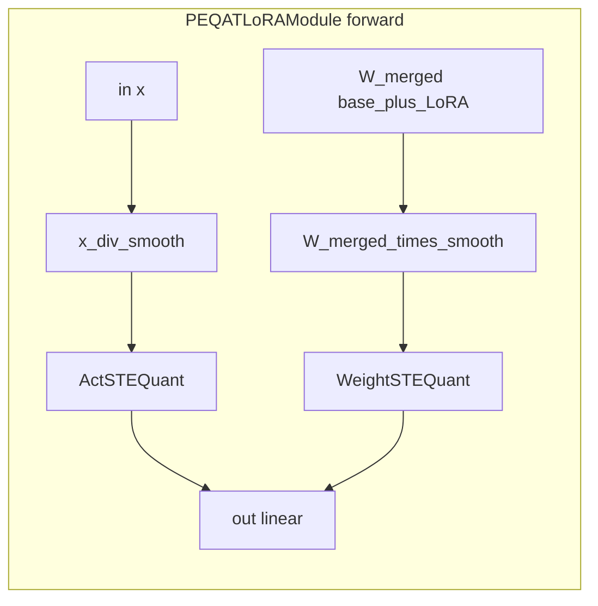

# PE-QAT codebase map and technical tradeoffs

This document maps the repository to the PE-QAT method (frozen backbone, LoRA + fake W4A4, learned activation clipping and SmoothQuant-style factors) and records implementation tradeoffs relative to the paper and to on-device deployment.

## What the codebase implements

### Core quantization and checkpoints — [`fake_quant.py`](fake_quant.py)

Single source of truth for forward/backward behavior and artifact layout:

| Symbol | Role |
|--------|------|
| `QATW4A4LinearCore` | Wraps the frozen `original_linear`; trainable `activation_clip` and `smooth_factor` (both length `in_features`, per input channel). |
| `PEQATLoRAModule` | Replaces each PEFT LoRA linear with the PE-QAT forward path. |
| `ActSTEQuant` | Symmetric activation fake-quant: PACT clamp to per-channel clips, round, STE backward; optional `use_quant_grad` adds an LSQ-style term for clip gradients. |
| `WeightSTEQuant` | Symmetric weight fake-quant: per **output row** of `[out, in]`; scale from row `abs().amax` with **`detach()`** on weights for the scale; STE returns `grad_output` w.r.t. weights. |
| `quantize_model` / `quantize_peft_gpt2` | Finds LoRA modules and swaps in `PEQATLoRAModule`. |
| `load_peqat_model` | Builds base + `get_peft_model`, runs `quantize_model`, loads `adapter_model.safetensors` (with key remapping for `.default`), loads `quantization_params.pth` if present, sets `use_quant_grad=False` on `PEQATLoRAModule` for inference-style forward. |
| `SaveQuantParamsCallback` / `save_quantization_parameters` | Persist `activation_clip` and `smooth_factor` per module to `quantization_params.pth` (keys like `{module_name}.activation_clip`). |

**`PEQATLoRAModule.forward` (conceptual)**

1. `get_merged_weight()`: `base_weight.detach() + (lora_B @ lora_A) * scaling` — gradients flow only through LoRA, not the frozen base.
2. SmoothQuant-style rescaling: `x_scaled = x / smooth`, `W_scaled = W_merged * smooth` (broadcast) — matmul equivalent to full precision before quantization in the continuous limit.
3. `quant_input = ActSTEQuant(x_scaled, …)`; `quant_weight = WeightSTEQuant(W_scaled, …)`; `F.linear(quant_input, quant_weight, bias)`.

### Training pipeline — [`peqat_training.py`](peqat_training.py)

1. Load causal LM and tokenizer from config; optional `resize_token_embeddings`.
2. `get_peft_model(model, lora_config)`; freeze `peft_model.base_model` parameters.
3. `quantize_model(peft_model)` to inject `PEQATLoRAModule`.
4. Configure `use_quant_grad` from config; optional freeze/init of `smooth_factor` / `activation_clip` (`learn_smooth`, `learn_clip`, `calibrate_smooth`).
5. `unified_calibration(...)` from [`calibrations.py`](calibrations.py) on a short dataloader pass.
6. AdamW parameter groups: LoRA, clips, smooth factors (separate LR multipliers).
7. HuggingFace `Trainer` with `SaveQuantParamsCallback` (and optional `GradientMonitorCallback`).
8. Save `save_pretrained(output_dir)`, tokenizer, best-checkpoint `quantization_params.pth` copy to output root.

### Calibration — [`calibrations.py`](calibrations.py)

- `unified_calibration`: forward hooks on `PEQATLoRAModule` collect per-module activation statistics and weight column max; with `use_smooth=True`, sets `smooth_factor ∝ A^α / W^(1-α)` then initializes clips from **scaled** activations. **Implementation note:** activation statistic is effectively **amax** over the calibration batches (not a true percentile), despite naming like `act_pctl` in places.

### Optional paths

- **[`fused_ops.py`](fused_ops.py)** — `PEQATLoRAModuleFused`: fused forward + custom autograd (`FusedActSTEQuant`, `FusedWeightSTEQuant`). Not enabled by default in `peqat_training.py`. Backward details can differ slightly from the unfused stack (e.g. clip term stabilization).
- **[`benchmark_real_quant.py`](benchmark_real_quant.py)** — toy packed INT4 weights + dequant matmul; useful for experiments, not the main training/inference path.
- **[`checkpoint_peqat_training.py`](checkpoint_peqat_training.py)** — resume training via `load_peqat_model(checkpoint_dir, ...)`.

---

## Technical tradeoffs (paper / product vs this repo)

1. **Fake quant at inference** — `load_peqat_model` still runs float `F.linear` on fake-quantized tensors. True on-device speed and memory need packed weights and kernels (and a defined activation path), not only STE-trained floats.
2. **Weight scales** — Per-row max, non-learnable (detached absmax). Simple and stable; some QAT methods learn scales; this repo relies on LoRA + STE to absorb error.
3. **Activation clips** — One learned bound per input channel, shared across tokens; cheaper than per-token observers but less expressive for rare spikes.
4. **Calibration vs naming** — Smooth/clips are data-informed, but activation aggregation is amax-heavy, not literal high-percentile, unless you change the hook.
5. **Gradient paths (unfused)** — `ActSTEQuant` does not return a gradient for `smooth_factor`; smoothing still receives gradients via autograd through `x / smooth` and `W * smooth` outside the custom op. Fused path implements `grad_smooth_factor` explicitly inside the op.
6. **Trainable parameter scope** — Only where LoRA is attached (see `lora.target_modules` in config). Other linears remain FP; W4A4 is not global unless you extend targets.
7. **Artifacts** — Deployers must ship **`adapter_model.safetensors`** (or equivalent) **and** **`quantization_params.pth`** so clips and smooth factors match training.

---

## On-device INT4 export (deployment gap)

To go beyond fake quantization at inference:

1. **Weights** — For each `PEQATLoRAModule`, compute final merged `W` (base + LoRA), apply trained `smooth_factor` as in forward, then apply the same symmetric per-row quant rule as `WeightSTEQuant` to obtain int4 bins and FP scales; pack for your runtime (see sketch in `benchmark_real_quant.py`).
2. **Activations** — Runtime must apply `x / smooth`, symmetric clip to stored `activation_clip`, scale, and round to int4 consistently with `ActSTEQuant` (including edge cases at clip boundaries). If the runtime uses only round-to-nearest int kernels, match this spec exactly or accept drift.
3. **Optional fusion** — Merge LoRA into base once for a single weight tensor per layer to simplify deployment (then drop adapter matrices on device).
4. **Validation** — Bit-exact or statistical parity checks between PyTorch fake-quant forward and the deployed kernel on calibration batches.

---

## Files to read first

| Role | File |
|------|------|
| Quant + load/save | [`fake_quant.py`](fake_quant.py) |
| Train loop | [`peqat_training.py`](peqat_training.py) |
| Init smooth/clips | [`calibrations.py`](calibrations.py) |
| Speed experiment | [`fused_ops.py`](fused_ops.py) |
| INT4 packing demo | [`benchmark_real_quant.py`](benchmark_real_quant.py) |
